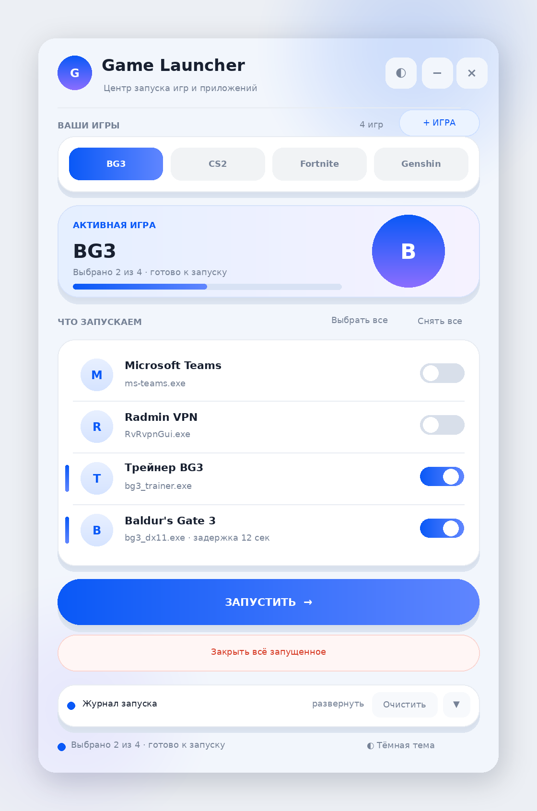
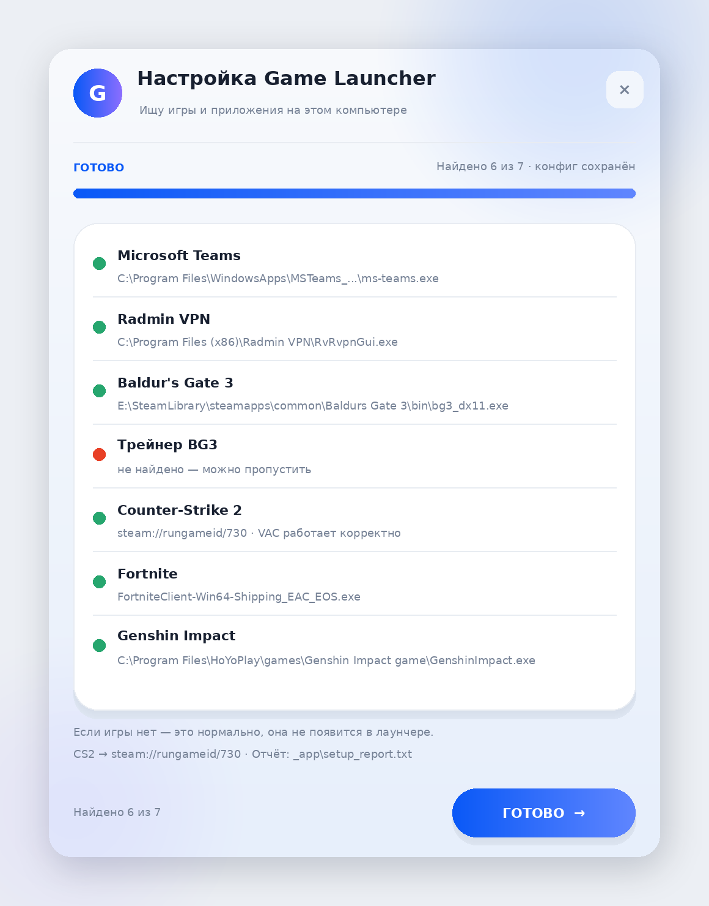
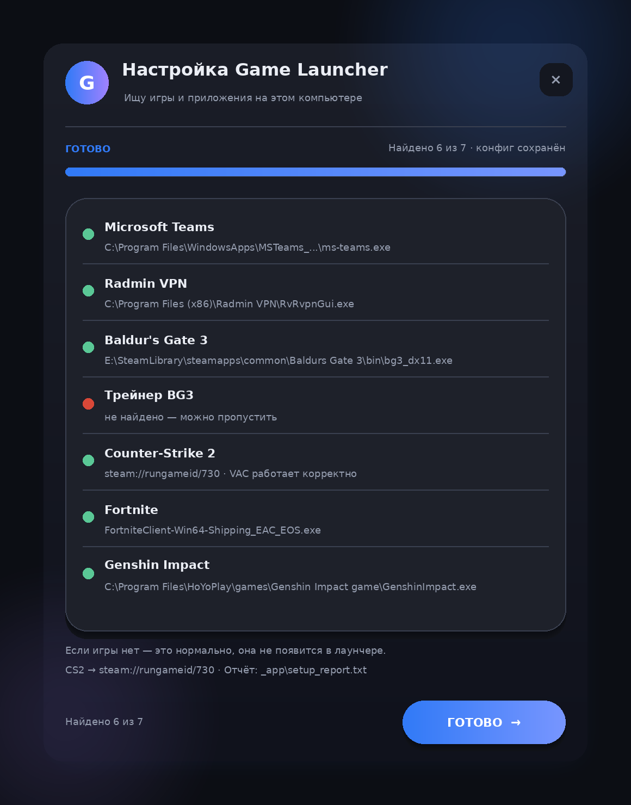
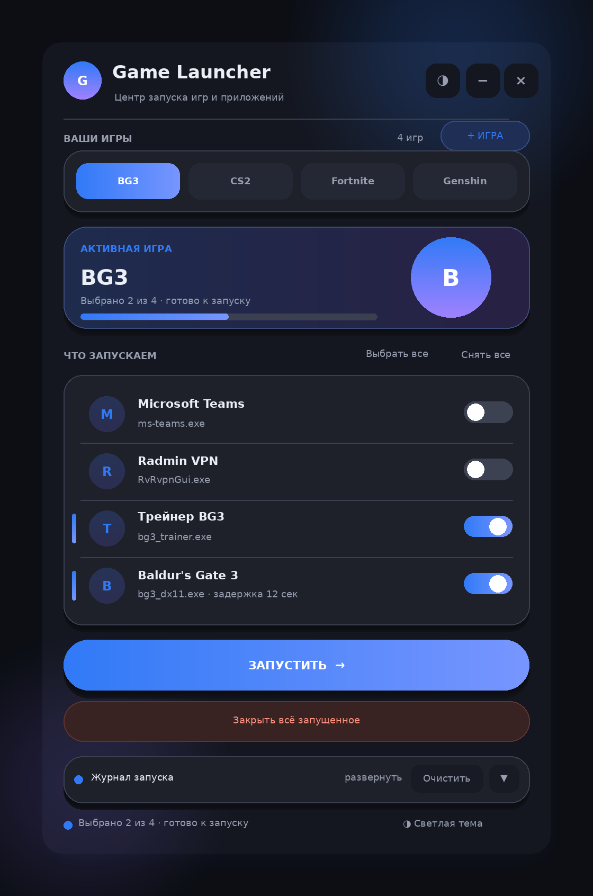

# 🎮 Game Launcher · Harmony Edition

**Лёгкий лаунчер игр на PowerShell + WinForms в стиле HarmonyOS**

Один клик — и запущено всё нужное: игра, трейнер, Radmin VPN, чат.

---

## 📖 Содержание

- [Что это](#-что-это)
- [Возможности](#-возможности)
- [Скриншоты](#-скриншоты)
- [Установка](#-установка)
- [Использование](#-использование)
- [Свои игры и программы](#-свои-игры-и-программы)
- [Формат config.ini](#-формат-configini)
- [Решение проблем](#-решение-проблем)
- [Структура проекта](#-структура-проекта)

---

## 💡 Что это

**Game Launcher** — это персональный центр запуска игр. Вместо того чтобы перед
каждой игровой сессией вручную открывать трейнер, потом Radmin VPN, потом игру,
а после игры закрывать всё это через диспетчер задач — лаунчер делает это
галочками в одном окне.

Проект полностью **self-contained**: никаких установок, никаких зависимостей,
только встроенный в Windows PowerShell. Скачал — запустил — играешь.

> Окей, мы переписали UI трижды, победили вотчдога трейнера и научились
> поднимать права через UAC. Наслаждайтесь 🙂

## ✨ Возможности

### 🎯 Пресеты игр
Каждая игра — отдельная вкладка-капсула со своим набором программ:

- **Baldur's Gate 3** — трейнер → пауза 12 сек → игра (трейнеру нужно время
  подхватить процесс игры!)
- **Counter-Strike 2** — игра через `steam://rungameid/730` (VAC-safe) + VK-чат
- **Fortnite**, **Genshin Impact** — со своими наборами

### ➕ Свои игры и программы
Кнопка **«+ ИГРА»** открывает менеджер, где можно:

- создать любую игру (Dota 2, HSR, ZZZ — что угодно);
- добавить в неё программы-компаньоны (трейнеры, Radmin, браузер с чатом);
- импортировать **всю библиотеку Steam** автоматически;
- удалить добавленное.

### 🔍 Мастер настройки
`setup.bat` при первом запуске **сам находит** на компьютере:

- Microsoft Teams (Store-версия и классическая);
- Radmin VPN;
- Baldur's Gate 3 (через библиотеки Steam);
- трейнер BG3 (сканирует Рабочий стол, Загрузки, D:\Programs);
- Counter-Strike 2, Fortnite (в т.ч. через Epic Games Launcher), Genshin Impact.

Чего не нашёл — предложит выбрать файл вручную.

### 🛑 «Закрыть всё запущенное»
Самая честная кнопка проекта. Лаунчер помнит, что запустил, и закрывает это
в три ступени:

1. **По-хорошему** — отправка `WM_CLOSE` (как будто нажал крестик);
2. **Принудительно** — плотный цикл убийств каждые 200 мс в течение 10 секунд
   (против вотчдогов, которые воскресают свои процессы);
3. **Через UAC** — если программа запущена от администратора, Windows покажет
   стандартный запрос повышения прав.

С подтверждением и напоминанием **сначала сохраниться в игре**.

### 🌗 Светлая и тёмная темы
Дизайн в стиле HarmonyOS: `#0A59F7` / `#317AF7`, капсулы, карточки, мягкие
тени, кастомные переключатели. Тема переключается на лету и запоминается.

### ⏱ Асинхронные задержки
Пункт запуска может подождать: `3Delay=12` — «запустить этот пункт через
12 секунд после предыдущего». Нужно для трейнеров, которым надо успеть
подцепиться к игре.

### 📜 Журнал запуска
Все действия — с цветовой подсветкой в интерфейсе и полным логом
в `_app/launcher.log`.

## 📸 Скриншоты

### Мастер настройки (`setup.bat`)

Сам находит игры и приложения, предлагает выбрать вручную то, что не нашёл:

### Главный интерфейс

Пресеты игр, выбор программ галочками, запуск и закрытие одним кликом:

## 🚀 Установка

1. **Скачай** репозиторий: зелёная кнопка **Code → Download ZIP** → распакуй.
2. **Запусти `setup.bat`** — мастер найдёт игры и создаст `_app/config.ini`.
3. **Запусти `Launcher.vbs`** — откроется лаунчер.
4. *(Необязательно)* запусти `make_shortcut.ps1` — он создаст на рабочем столе
   ярлык **Game Launcher** с иконкой.

> ⚠️ Windows SmartScreen может предупредить о неизвестном издателе —
> «Подробнее» → «Выполнить в любом случае». Это нормально для
> PowerShell-скриптов без цифровой подписи.

**Требования:** Windows 10/11, PowerShell 5.1 (встроен в систему). Ничего
устанавливать не нужно.

## 🕹 Использование

1. Выбери игру — капсула вверху окна.
2. Проверь галочки — что запускаем (оптимальный набор уже отмечен).
3. **ЗАПУСТИТЬ →**
4. После игры — **«Закрыть всё запущенное»** (сначала сохранись!).

## ➕ Свои игры и программы

Кнопка **«+ ИГРА»** в шапке окна → четыре вкладки:

| Вкладка | Что делает |
|---|---|
| **Новая игра** | Название + путь к exe (или `steam://rungameid/<id>`) + аргументы |
| **+ Программа** | Добавляет трейнер / Radmin / что угодно внутрь существующей игры |
| **Steam** | «НАЙТИ» покажет все установленные Steam-игры → отметь → «ИМПОРТИРОВАТЬ» |
| **Мои игры** | Удаление добавленных игр (стандартные защищены) |

Импортированные из Steam игры запускаются через `steam://rungameid/<appid>` —
это официальный протокол Steam, **VAC работает корректно**.

## ⚙️ Формат config.ini

Конфиг создаётся мастером настройки, но его можно править руками:

